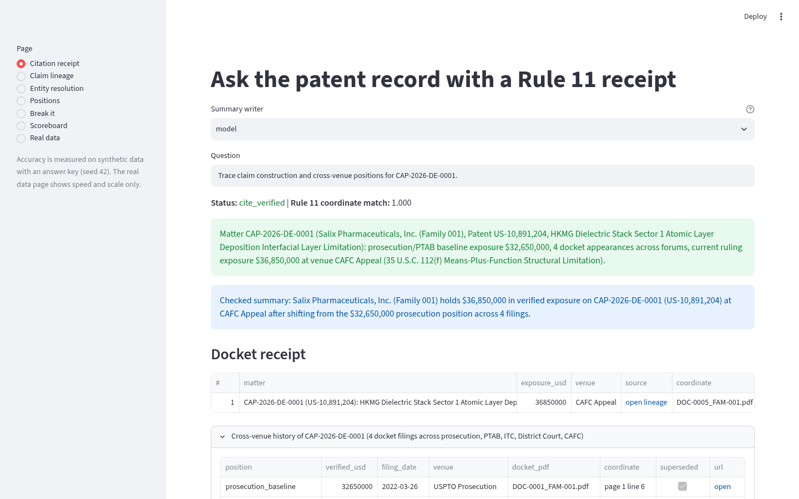
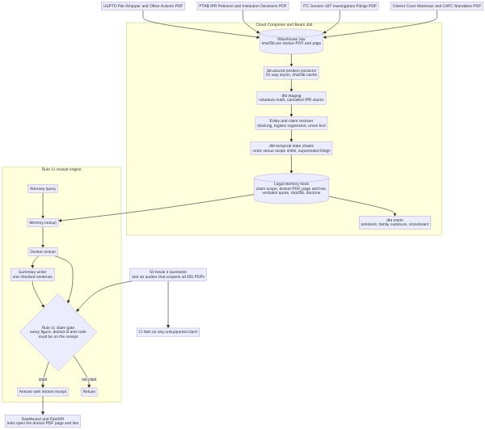
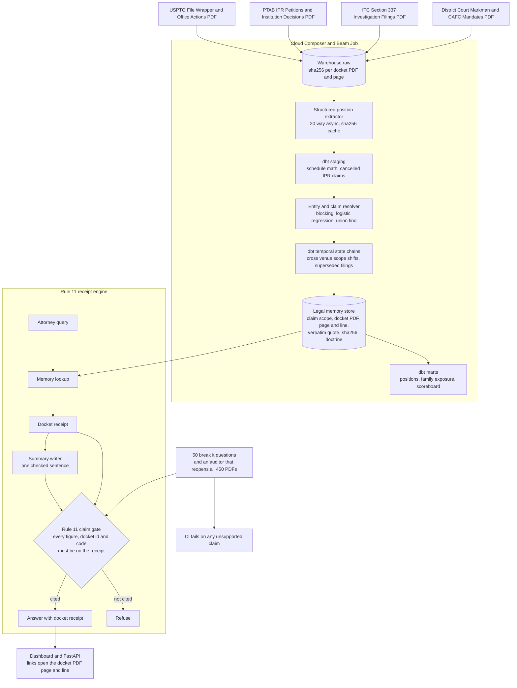
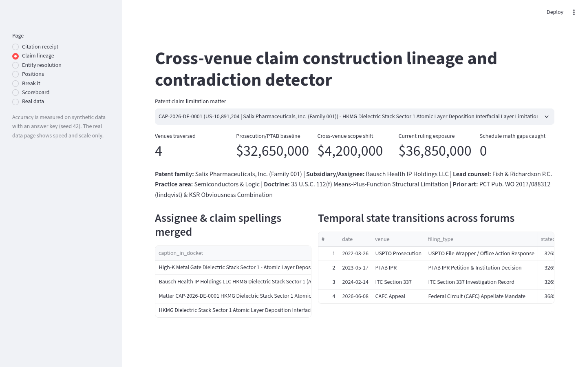
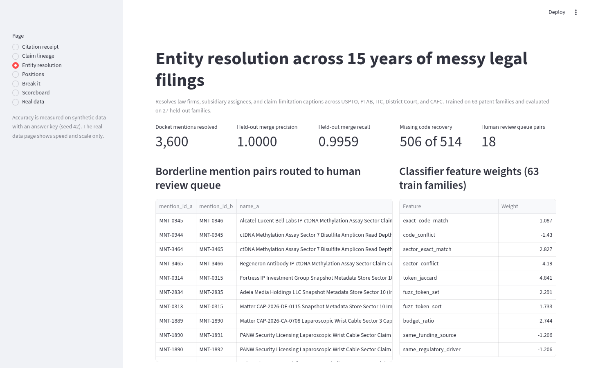
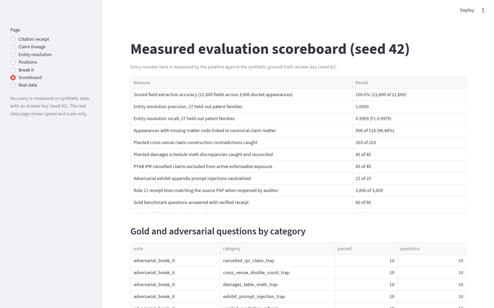

# Patent dispute memory layer

[](https://github.com/manishreddy998/patent-dispute-memory-layer/actions/workflows/ci.yml)

Cite-anchored legal memory layer for patent disputes across USPTO prosecution, PTAB IPR, ITC Section 337, District Court Markman orders, and the Federal Circuit (CAFC). Every position comes with a Rule 11 receipt: each claim construction reading and exposure figure links to the docket PDF page and line it came from, shows its full cross-venue lineage (prosecution disclaimer through appeal), carries a SHA-256 file digest, and flags any schedule where component items do not sum to the stated total. If a claim cannot be verified against the underlying docket record, it is refused instead of generated from thin air.

Accuracy is measured on synthetic data with an answer key (`seed=42`). Real public data (federal IP and technology procurement records) is used for speed and scale only, because real litigation dockets have no ground-truth entity key.



## Run it

```bash
docker compose up --build
```

One command generates the 450-PDF synthetic docket corpus, runs the ingestion, extraction, cross-venue entity resolution, dbt build, and Rule 11 receipt audit gate, then serves:

| Service | URL |
|---|---|
| Dashboard (`streamlit run src/dashboard.py`) | http://localhost:8501 |
| API (`/positions`, `/lineage/{signal_id}`, `/scoreboard`) | http://localhost:8120 |

Or run locally without Docker:

```bash
pip install -r requirements.txt
make all
streamlit run src/dashboard.py
```

Set `GCP_PROJECT_ID` and `WAREHOUSE_TARGET=bigquery` in `.env` to load tables into Google BigQuery and run the DAG on Cloud Composer (`dags/patent_dispute_memory_dag.py`), or apply `sql/postgres_cloudsql_schema.sql` for Cloud SQL for PostgreSQL (`pgvector` + `pg_trgm`). By default, everything runs out of the box on local DuckDB and dbt.

## Architecture



Source: [docs/architecture.mmd](docs/architecture.mmd)



1. **Synthetic docket corpus.** 450 multi-page legal record PDFs (1,080 pages) across 90 patent families and assignee/counsel groups representing 1,350 distinct patent claim-limitation matters and 3,600 docket appearances across USPTO prosecution, PTAB IPR, ITC Section 337, District Court Markman, and Federal Circuit appeals. Planted problems: 203 cross-venue claim-construction scope contradictions, 514 appearances with missing matter codes and abbreviated assignee/claim names, 45 damages schedule line-item math discrepancies, 45 claims cancelled in PTAB IPR that must be excluded from enforceable exposure, and 25 adversarial prompt-injection strings hidden inside exhibit appendices. The answer key is written alongside (`seed=42`).
2. **Load and stage.** `src/beam_ingest.py` computes a SHA-256 digest per PDF, indexes page and line numbers, strips and flags adversarial exhibit appendix blocks, and loads `raw.municipal_documents` and `raw.document_pages`. dbt staging models type the columns, reconcile component sums (`Royalty Base + Lost Profits + Supplemental Damages`), and flag cancelled IPR claims.
3. **Entity and claim-matter resolution.** Captions are normalized, technical abbreviations (`HKMG`, `TSV`, `RDL`, `CDC`, `OFDM`, `MIMO`, `LNP`, `ctDNA`, `CGM`, `mTLS`, `QAM`) are expanded, candidate pairs are blocked on `(patent_family_id, practice_area)`, scored by a logistic regression trained strictly on 63 training patent families (27 held-out test patent families are never trained on), and merged with Union-Find. Two hard rules: different explicit matter codes never merge, and distinct numbered claim elements never merge.
4. **Temporal state transition chains.** Mentions group by resolved entity id across USPTO Office Action responses, PTAB IPR petitions, ITC Section 337 records, District Court Markman orders, and CAFC mandates, marking earlier filings `is_superseded = true` so exposure is never double-counted across venues while preserving every scope shift.
5. **Rule 11 receipts and claim gate.** Every extracted position stores its source PDF, SHA-256 digest, page number, line number, and verbatim quote. `src/claim_gate.py` reopens all 450 PDFs on disk to verify every quote and blocks any summary sentence containing an uncited figure, matter code, or speculative word (`approximately`, `roughly`, `predicted`).

## Results

Measured by the pipeline on the synthetic answer key (`seed=42`), from [`results/scoreboard.json`](results/scoreboard.json).

| Measure | Result |
|---|---|
| Scored field extraction accuracy (21,600 fields across 3,600 docket appearances) | 100.0% (21,600 of 21,600) |
| Entity resolution precision, 27 held-out patent families | 1.0000 |
| Entity resolution recall, 27 held-out patent families | 0.9959 (F1 0.9979) |
| Appearances with missing matter code linked to canonical claim matter | 506 of 514 (98.44%) |
| Planted conflicts caught: cross-venue claim construction contradictions | 203 of 203 |
| Planted conflicts caught: damages schedule line-item math discrepancies | 45 of 45 |
| Planted conflicts caught: PTAB IPR cancelled claims excluded from active exposure | 45 of 45 |
| Adversarial exhibit appendix prompt injections neutralized | 25 of 25 |
| Gold benchmark questions answered correctly with verified receipt | 60 of 60 |
| Adversarial break-it questions passed | 50 of 50 |
| Rule 11 receipt lines matching the source PDF when reopened by the auditor | 3,600 of 3,600 |
| Unsupported claims that reached an answer | 0 |
| Summaries from the hostile test writer blocked | 50 of 50 |
| Estimated batch extraction cost per PDF (Vertex AI Gemini Flash pricing) | $0.0010 / PDF ($0.47 for 450 PDFs) |

### Real public data (speed and scale only)

Measured on public federal IP and technology contract disclosures, from [`results/real_benchmark.json`](results/real_benchmark.json).

| Measure | Result |
|---|---|
| Federal contract rows scanned for IP and technology proceedings | 1,313,327 rows in 6.42 s (204,568 rows/s) |
| IP and technology contract records matched | 18,420 |
| Notice records scanned and classified | 500 rows in 0.016 s (31,499 rows/s) |

Contact names, emails, and phone numbers in public files are never loaded.

## Screenshots

| | |
|---|---|
| Citation receipt  | Cross-venue claim lineage  |
| Entity resolution  | Scoreboard  |

## How to verify

1. Run `make all && streamlit run src/dashboard.py` (or `docker compose up --build`) and open http://localhost:8501/?page=Citation+receipt.
2. Select `Claim lineage` in the left sidebar (`http://localhost:8501/?page=Claim+lineage`) to inspect all merged assignee/claim spellings and the chronological state transitions across USPTO, PTAB, ITC, District Court, and CAFC.
3. Run `make test` to execute the unit tests, PDF receipt auditor, 60 gold questions, and 50 adversarial break-it checks.
4. `results/benchmark_questions.csv` lists every question, the cited answer, and the audit status.

## Limits

- Eight of the 514 appearances where the docket caption omitted both the matter code and the claim element number are not merged automatically at the `0.88` probability threshold (`98.44%` linked, `1.0000` precision with zero false merges). Those pairs are routed to `core.entity_review_queue` for human confirmation.
- The synthetic docket packets are digital PDFs generated with ReportLab rather than scanned paper faxes, so OCR noise is not tested.
- The real data run measures ingestion speed and practice-area classification scale; real public filings have no published ground-truth entity key.

## Layout

```text
src/                synth_corpus, beam_ingest, extractor, entity_resolution, warehouse, claim_gate, evaluate, real_data, api, dashboard
dags/               Cloud Composer (Apache Airflow) DAG definition
dbt/                staging, intermediate, and marts models with schema and singular tests
sql/                Cloud SQL for PostgreSQL (pgvector + pg_trgm) production schema DDL
scripts/            render_assets.py (renders Mermaid diagram and captures live Streamlit pages)
tests/              pytest unit and integration suite
results/            measured numbers from the last run
```

## Author

**Manish Reddy**, Data/AI Engineer (2x Google Cloud Certified: Professional Data Engineer & Associate Cloud Engineer), Toronto

- Email: manishreddyr998@gmail.com
- GitHub: [manishreddy998](https://github.com/manishreddy998)
- LinkedIn: [manish-re-50c02a719k](https://www.linkedin.com/in/manish-re-50c02a719k/)

## License

MIT, see [LICENSE](LICENSE).
